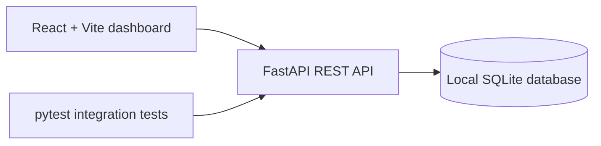

# TeamForge — Digital Solution9 Engineering Portfolio

## v0.5: Engineering upgrade

**Current authentication:** First owner registration requires a server-configured `OWNER_SETUP_TOKEN`. Protected API routes use an HTTP-only session cookie. Owner password changes revoke all active sessions. In production mode (`APP_ENV=production`), the cookie is always `Secure`, even if `COOKIE_SECURE=0` is mistakenly configured. Local HTTP demos should leave `APP_ENV` unset. This is **single-owner demo access**, not organisation RBAC.


**Current documented features:** Task comments and workspace-scoped Kanban board API.

**Security:** owner-only session authentication, password hashing, session revocation and an operator-provided first-account token (`OWNER_SETUP_TOKEN`) now protect the API. Create a unique 24+ character token in your local environment before initial registration. No real user/client data should be entered.

**Run locally:** In `backend/`, install `requirements.txt`, set `OWNER_SETUP_TOKEN` to a random secret (for example, generate one with `python -c "import secrets; print(secrets.token_urlsafe(32))"`), then run `uvicorn main:app --reload`. In `frontend/`, run `npm install` and `npm run dev`. Register the first owner with the same setup token in the login screen. Afterward, additional registration is disabled. Run tests using `cd backend && python -m pytest -q`.

**Scope:** This is a local portfolio MVP, not a deployment-ready, multi-user, audited production service. Production mode (`APP_ENV=production`) now forces secure cookies; use real HTTPS and complete a deployment security review before exposing any service. Previous notes below describe earlier releases and may not reflect the current authentication behavior.

---

# TeamForge

> Multi-workspace project & task management

**Status:** Working local portfolio MVP, not a production-ready SaaS. The UI and API persist data in a local SQLite database. **This is a single-owner authenticated demo, not a multi-tenant system.**


## What's new in v0.3

**Focus:** auditable task changes.

- Workspace-specific activity audit trail
- Task creation, status, edits and deletion recorded
- Workspace activity filter and bounded pagination

The **Advanced tools** panel on the dashboard exercises the new API endpoints. The backend smoke tests now include a regression test for this functionality.

## Architecture



The app is a **single-owner authenticated local MVP**, not an enterprise multi-tenant production service. It does not implement separate user/tenant roles. Use synthetic data only.

## GitHub repository description

> Task tracking with multi-workspace filters, editing, due dates, and an audit trail.

## Main v0.3 APIs

- Standard: `GET /api/health`, `GET /api/items`, `POST /api/items`, `GET /api/summary`
- `GET /api/activity`

## Portfolio story

**Engineering focus:** Full-stack architecture, workspace scoping, task workflows.  
**Implemented features:** workspaces and tasks, create/read/update/delete operations, status transitions, workspace filters, keyword search, pagination and workspace-specific status summaries.

## Stack

- **Frontend:** React 19, Vite, vanilla CSS, responsive dashboard
- **Backend:** Python 3.11+, FastAPI, SQLite, OpenAPI / Swagger
- **Testing:** pytest, FastAPI TestClient (basic API smoke tests)

## Run locally

Use **two terminals**:

```bash
cd backend
python -m venv .venv
source .venv/bin/activate  # Windows: .venv\Scripts\activate
pip install -r requirements.txt
uvicorn main:app --reload --port 8000
```

```bash
cd frontend
npm install
npm run dev
```

Open **http://localhost:5173** and view API documentation at **http://localhost:8000/docs**.

## Sample data

```bash
cd backend
python seed_demo.py
```

Inserts synthetic records into an empty local database. The uptime monitor starts empty by design because checks require network access.

## Tests

```bash
cd backend
python -m pytest -q
```

## API endpoints

| Method | Path | Purpose |
|---|---|---|
| GET | `/api/health` | Service health |
| GET | `/api/items` | Filter and search tasks; accepts `workspace`, `status`, `search`, `limit`, `offset` |
| GET | `/api/items/{id}` | Retrieve one task |
| POST | `/api/items` | Create a task |
| PATCH | `/api/items/{id}?status=Done` | Change task status (existing frontend compatible) |
| PUT | `/api/items/{id}` | Edit supplied task fields |
| DELETE | `/api/items/{id}` | Delete a task |
| GET | `/api/summary?workspace=...` | Task counts per status, optionally scoped |

**Engineering improvements in v0.2:** bounded query pagination, typed status/priority validation, escaped LIKE searches, workspace-status index, database rollback on errors, isolated temporary-database tests. Six backend tests pass locally. This remains a single-owner demo: workspace filtering is **not** multi-user permission isolation.

## Suggested portfolio extensions

- Extend owner-only login into reviewed multi-user authorisation and role-based permissions
- Move to PostgreSQL with managed migrations
- Extend integration and browser test coverage
- Add GitHub Actions, container deployment, monitoring and observability
- Conduct accessibility and security review before any public production deployment

## Security / limitations

This MVP now implements single-owner login, hashed passwords, session revocation, basic login throttling and mutation audit records. It does **not** implement multi-user authorisation, distributed rate limiting or audited production hardening. Use **synthetic demonstration data only**, especially for medical and client-oriented projects. The monitoring application must not be hosted publicly without further network-isolation/SSRF protections. Payments, real medical data, and LLM integrations are intentionally **not** implemented. Do not claim otherwise on your CV.

## License

MIT. See LICENSE.

---

## Portfolio showcase & quality checks

[](https://github.com/shakaleita/teamforge-saas/actions/workflows/portfolio-checks.yml)

**Engineering focus:** Task modeling, task activity history, and workspace reporting.

Part of my [10-project full-stack engineering portfolio](https://github.com/shakaleita/teamforge-saas/blob/main/PORTFOLIO.md). Browse the full collection for related domain projects and engineering trade-offs.

**Project status:** Local portfolio MVP. CI exercises backend tests and the frontend build; an automated check does not imply production security or a deployed demo. The current source includes owner-only authentication, password rotation and session revocation. Older version notes are preserved for historical context.
